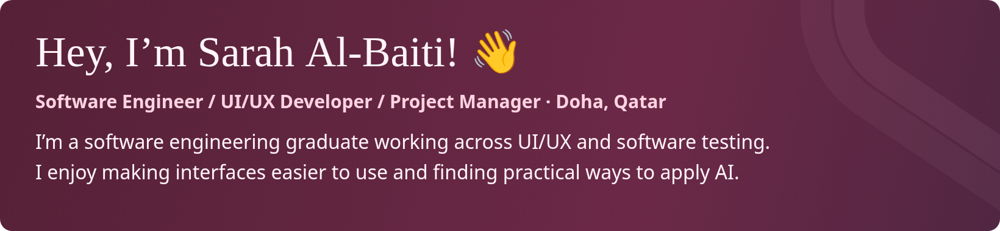

## Background

| Area | Details |
| --- | --- |
| **🎯 Current focus** | Full Stack \& UI/UX Development |
| **🎨 UI/UX** | I map user flows, prototype in Figma, and use usability testing to refine interfaces. I’ve also designed for both English and Arabic. |
| **💼 Previous role** | Software Engineer / Project Manager at PMOBytes. I led software testing cycles as Scrum Master, managed QPunch client support, and wrote onboarding guides. |
| **🎓 Education** | BSc (Hons) Software Engineering, First Class · APU and Staffordshire University. |
| **🔗 Connect** | [LinkedIn](https://qa.linkedin.com/in/sarah-al-baiti-975346151) |

## 🛠️ Tools I’ve used

### Design \& web

  

### Development \& AI

  

### Mobile development

  

### QA \& delivery

   

### Web publishing \& hosting

  

## ✨ Featured projects

### School Management System

I designed a clickable, bilingual Figma prototype for a school management system. I mapped eight workflows across five user roles, from setting up a school to taking attendance and publishing results. The prototype includes English and Arabic right-to-left layouts.

[Explore the interactive prototype](https://sarah-albaiti.github.io/SMS-prototype/)

### Blood Rush

For my final-year project, I built a blood donation companion for Android using Java and Firebase. I implemented separate donor and recipient flows, blood-group filtering, and donation requests. I tested the app with users and earned an A+ for the project.

### CertiMinds chatbot

I built a Python and Streamlit chatbot prototype for questions about the CertiMinds website. It uses the Groq API and a curated knowledge file, with a fallback for questions the file doesn’t cover.

## 🎓 Certifications \& coursework

### Microsoft certification

- [Microsoft Certified: Azure Data Fundamentals (DP-900)](https://learn.microsoft.com/en-us/users/sarahalbaiti-3168/credentials/9cfa61e5c4bc9965)

### Google UX courses

- [Foundations of User Experience (UX) Design](https://coursera.org/share/6c2b9cc9540bd3c792df9667cd97d4a2)
- [Start the UX Design Process: Empathize, Define, and Ideate](https://coursera.org/share/ffebc88577c44bf640d45306648eac63)

### AI and development courses \& badges

- [AI-Native Development Practitioner (Coursera badge)](https://www.coursera.org/account/accomplishments/badge/c6AzYniXT3mgM2J4l795cQ)
- [AI Fundamentals with Claude](https://www.coursera.org/account/accomplishments/records/4AHUQO29HWYU)
- [AI Collaboration with Claude](https://www.coursera.org/account/accomplishments/records/IC8EI4T66XQ8)
- [AI Automation with Claude](https://www.coursera.org/account/accomplishments/records/UU7WC0ITTMYT)
- [Claude Code in Action](https://www.coursera.org/account/accomplishments/records/MGCBBEMO4SLH)
- [Command Line (CLI) \& Terminal Basics](https://www.coursera.org/account/accomplishments/records/TFANFQ2XNW09)
- Introduction to Software Engineering (Coursera)
- Introduction to Git and GitHub (Coursera)
